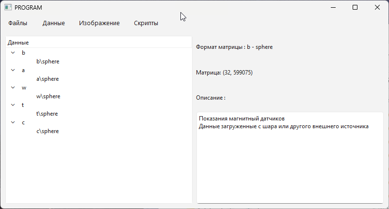
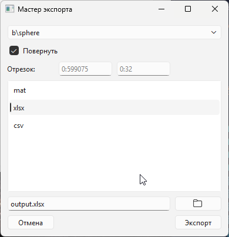
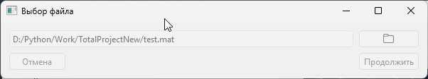
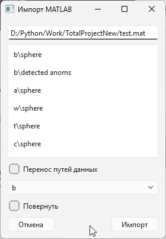
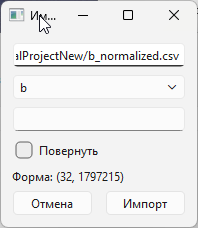
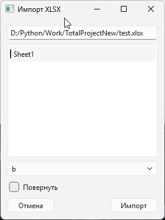
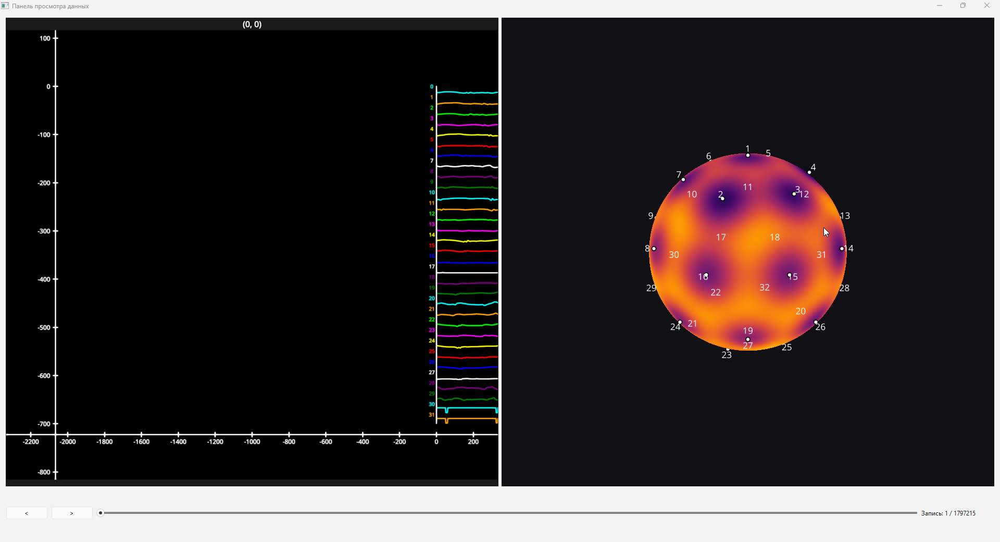
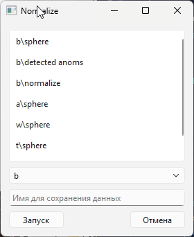

# Sphere-Reader
Программа для чтения и обработки данных, полученных с сенсора ВИП «СИГМА». Она позволяет загружать файлы .sgm, строить графики, отображать показания магнитных датчиков на 3D-модели сенсора, запускать обработку данных и экспортировать результаты.

# Установка и быстрый старт

Если вы используете установщик, достаточно указать, куда установить программу, а далее использовать `Launch.bat` для запуска.

Если вы устанавливаете программу из скачанного репозитория, вам потребуется Python версии 3.14.0. Если он не установлен, скачайте его с официального сайта: [Python](https://www.python.org/). 

Далее используйте модуль `pip` для установки зависимостей:
```
pip install -r requirements.txt
```
Затем запустите `main.py`:
```
python main.py
```

# Работа с программой

Вся работа в программе сводится к работе в "проекте". Проект в представлении программы — это набор данных, которые могут быть как импортированы извне, так и рассчитаны непосредственно во время работы с ними. 

Программу можно поделить на следующие части:
1. Главное окно - представление всех данных, существующих в проекте 
2. Файлы - работа с файлом проекта: сохранение и загрузка
3. Данные - импорт и экспорт данных проекта
4. Изображение - представление данных в виде графиков
5. Скрипты - пользовательские или встроенные функции для обработки данных

## Главное окно

Первая страница, которую видит пользователь при старте программы. Состоит из двух больших панелей: список данных слева, описание данных справа. 

Для чтения описания данных достаточно выбрать одну из строк слева, и справа появится информация.



Данные разделены по типам:
- b - показания магнитных датчиков
- a - показания акселерометра
- w - показания гироскопа
- t - показания тензометрических датчиков
- c - показания центрального магнитного датчика

Сверху расположена панель с инструментами. Общее описание её разделов приведено выше, в списке частей программы. 

## Файлы

- Новый проект - очищение открытого проекта (создание нового).
- Сохранить проект - сохраняет проект в файл. Если проект ранее не сохранялся, запросит указать путь сохранения
- Сохранить проект как - сохраняет проект в файл, однако, в отличие от обычного сохранения, запросит указать путь сохранения в любом случае
- Загрузить проект - загрузка проекта из файла

## Данные 

- Загрузить с шара - в данном случае под "шаром" понимается ВИП "СИГМА". Загружает файлы измерений в формате `.sgm` и автоматически распределяет данные по типам. В случае, если в проекте уже присутствуют данные с шара, он их соединит по временной шкале в один большой массив. 
- Экспорт в .mat - экспортирует данные в `.mat` файлы (файлы данных MATLAB).
- Экспорт в .csv - экспортирует данные в текстовые массивы `.csv`. Этот формат не поддерживает экспорт массивов размерностью выше двух.
- Мастер экспорта - функция для более гибкого экспорта данных
- Мастер импорта - аналогично мастеру экспорта, но для импорта

### Мастер экспорта 


Первая строка - это селектор (блок выбора) данных для экспорта. Можно выделить тип данных (в этом случае экспортируются все данные в типе) либо отдельный массив. 

Галочка "Повернуть" — при установке выполняется транспонирование данных перед экспортом.

Отрезок — выбор части массива для экспорта. Первое поле задаёт отрезок по первой оси (строкам), второе — по второй (столбцам). Для одномерного массива используется только первое поле. Для массивов размерностью выше двух отрезок не применяется.

Формат записи: `начало:конец`. Индексы отсчитываются с нуля. Начальный индекс включается, конечный — нет. Например:

- `0:100` — первые 100 элементов, с индексами от 0 до 99.
- `100:200` — следующие 100 элементов, с индексами от 100 до 199.
- `:100` — от начала до индекса 99; `100:` — от индекса 100 до конца.
- Пустое поле или `:` — все элементы по соответствующей оси.

Например, для массива из 12 строк и 1000 столбцов первое поле `0:3` и второе `100:200` выберут первые три строки и столбцы с индексами от 100 до 199. Результат будет иметь размер 3 × 100.

Если установлена галочка "Повернуть", отрезок применяется **после транспонирования**: строки и столбцы двумерного массива сначала меняются местами.

Панель с выбором — выбор формата, в который будут экспортированы данные. Поддерживаются:
- mat - данные MATLAB. Поддерживает экспорт массивов любой размерности.
- xlsx - можно экспортировать как типы данных целиком, так и отдельные массивы. Если у одного из экспортируемых массивов размер первой оси превышает 1048575 или второй — 16383, экспорт невозможен. Поддерживаются массивы размерностью не выше двух.
- csv - можно экспортировать массивы размерностью не выше двух, а также невозможно экспортировать типы данных.

Ввод внизу - имя файла. Если нажать кнопку в виде "папки", можно выбрать путь сохранения. 

Кнопки снизу: "Экспорт" — экспортирует данные, "Отмена" — закрывает окно без вопросов. 

### Мастер импорта


При нажатии на кнопку появится возможность выбора файла для импорта. Поддерживаются следующие типы:
- `.mat` - MATLAB данные
- `.csv` - текстовые массивы
- `.xlsx` - книга Excel

#### .mat



Первая строка — это путь к файлу для импорта.

Панель с данными показывает содержимое `.mat` файла. Можно выбрать один или несколько массивов для переноса.

Галочка "Перенос путей данных" - при установке во время импорта программа постарается совместить заголовок данных с типами данных программы. То есть если в `.mat` файле есть данные "b\123123", то программа импортирует их в тип данных b (магнитные датчики) с именем "123123". 

Выбор типа данных, куда будут импортированы данные (нужен, если не установлен флажок "Перенос путей данных").

Галочка "Повернуть" — по аналогии с экспортом выполняет транспонирование данных после импорта.

#### .csv



Проще, чем `.mat`. Есть строка с путём к файлу, выбор типа данных для импорта и галочка для транспонирования.
Однако в дополнение есть поле ввода имени данных, под которым они будут сохранены в проекте. 

#### .xlsx



В отличие от `.mat`, выбор данных представлен в виде листов книги Excel. В качестве имени данных будет выбрано имя листа.

## Изображение 

### 2D график

Двумерный график. 
Доступные функции: добавление линий графика и установка точек. 

Команда "График → Добавление графиков" добавляет выбранные данные на график. Для линии используется одномерный массив либо отдельная строка двумерного массива. По оси X откладывается индекс элемента: `0, 1, 2, …`, а по оси Y — его значение. Ось X сама по себе не является временем в секундах.

При добавлении нескольких линий за один раз программа сдвигает их по вертикали для удобства просмотра, поэтому отображаемая координата Y может отличаться от исходного значения на величину этого сдвига.

После добавления первой линии список доступных данных фильтруется по её длине. Например, если линия содержит 1000 значений, при следующем добавлении можно выбрать только линии из 1000 значений; массив из 800 значений в списке не появится. Для двумерного массива сравнивается длина отдельной строки (число столбцов), а не количество строк. Например, массив размером 12 × 1000 даёт 12 отдельных линий по 1000 значений.

Команда "График → Добавление точек" использует значения выбранного одномерного массива как координаты X для вертикальных меток. Например, массив `[100, 250, 700]` поставит метки на позициях X = 100, 250 и 700. Это не пары координат `(X, Y)`: двумерный массив можно использовать только через выбор его отдельных строк.

В текущей версии, если на графике уже есть линия, список для добавления точек показывает только массивы (или строки), длина которых отличается от длины линии. Например, для линии из 1000 значений массив из трёх меток доступен, а массив из 1000 меток — нет.

### 3D график

Во многом похож на двумерный график, но нужно дать подробности по управлению:
WASD - движение камеры вперёд\влево\назад\вправо
Shift\Space - движение камеры вниз\вверх
Колесо мыши вверх\колесо мыши вниз - ускорение\замедление движения камеры
Q\E - вращение по Roll влево\вправо
Alt + Колесо мыши вверх\колесо мыши вниз - уменьшение\увеличение FOV камеры

### Dashboard

Визуализация показаний сенсора в виде тепловой карты на его упрощённой 3D-модели. 
При открытии нужно указать данные магнитных датчиков для отображения. 

Далее откроется панель для просмотра данных:


Слева - данные в виде графиков, где вертикальной линией обозначен отображаемый кадр.
Снизу - выбор кадра (записи) с помощью ползунка либо покадрово кнопками. Если при нажатии кнопок зажать Shift, то будет выполнено перемещение не на 1, а на 10 кадров, если же зажать Ctrl, то шаг составит 100 кадров, а при зажатии Shift+Ctrl — 1000 кадров.
Справа отображена модель с нанесённой тепловой картой.

Цифрами на обоих графиках обозначены порядковые номера строк массива (если данные были загружены из ВИП, это порядковые номера датчиков).

### Скрипты

Это панель для выбора и запуска встроенных и пользовательских функций обработки данных. Все функции из "скриптов" хранятся в папке `scripts` рабочей директории программы. 

Самое простое окно для скрипта выглядит так:


Первое — это выбор данных для обработки. Далее идёт тип данных, в который будет сохранён итоговый массив, а также его имя. 

Остальные поля настраиваются и различаются у разных скриптов, так что их подробное описание затруднительно. 

#### Написание скриптов

Скрипты состоят из двух основных функций:

```py
def main(data: np.ndarray, params : dict) -> np.ndarray:
...
def config():
```

- `main` - основная функция, в которой и должен быть алгоритм обработки
- `config` - функция, которая возвращает dict с параметрами для окна ввода данных. 

Пример config:
```py
return {
        "name" : "Normalize",
        "shape" : [1, 2],
        "multiply" : False,
        "inputParams" : {}
        }
```
- `name` - Это имя функции для отображения в программе. 
- `shape` - Количество возможных осей в данных для подачи в функцию. То есть если задать `[1]`, то будет ожидаться массив `[x,]`, а если `[1, 2]`, то `[x,]` или `[x, y]`. 
- `multiply` - Возможен ли ввод нескольких массивов. В этом случае вместо одного массива будет передаваться список массивов (тип `list`, а не `np.ndarray`). 
- `inputParams` - Параметры для ввода. Вводятся в виде словаря, где ключ — это отображаемое имя, а значение — тип данных для ввода. Пример: `"inputParams" : {"window size" : int}`, в данном случае программа запросит "window size" в виде целого числа. Поддерживаются следующие типы: `int`, `float`, `str`.

### Build
Python 3.14.0
Для установки библиотек используйте `pip install -r requirements.txt`
